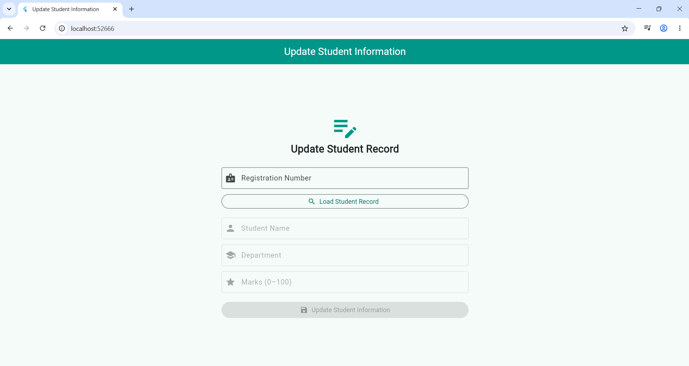
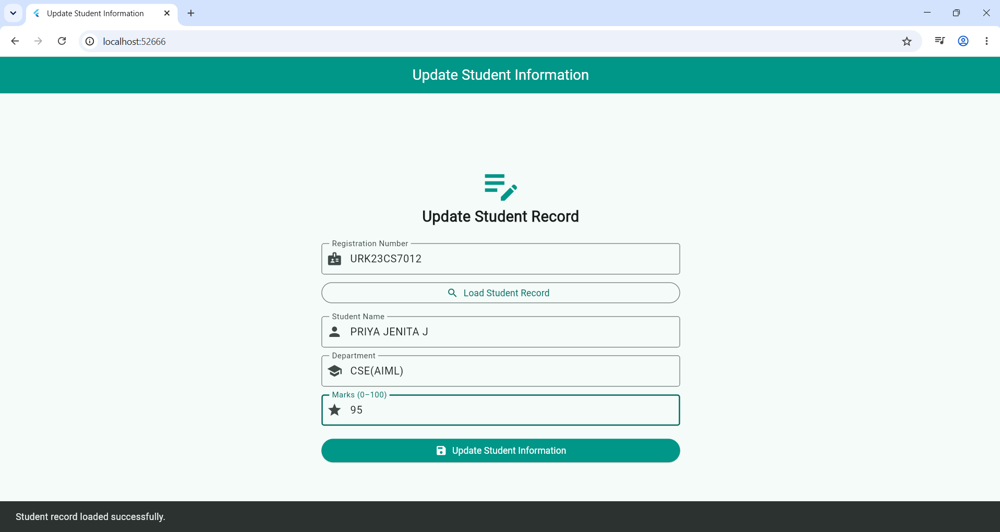

# Experiment 9: Update Information in Google Firestore Database

## Aim
To develop a Flutter application that updates existing student information stored in a Google Cloud Firestore database.

## Description
This experiment demonstrates how to update student records in Firebase Cloud Firestore using a Flutter application. The user enters a student's registration number and loads the existing details from the database. The user can modify the student's name, department, and marks and save the updated information to Firestore.

The application uses Firebase Core to initialize Firebase and the Cloud Firestore package to retrieve and update student records. The registration number is used as the document ID.

## Technologies Used
- Flutter
- Dart
- Firebase Core
- Google Cloud Firestore
- Visual Studio Code

## Database Structure
**Collection:** `students`

**Document ID:** Student registration number (e.g., `URK23CS7012`)

| Field | Data Type |
|---|---|
| name | String |
| registrationNumber | String |
| department | String |
| marks | Number |
| createdAt | Timestamp |
| updatedAt | Timestamp |

## Procedure
1. Create a Flutter project named `flutter_application_9`.
2. Add the `firebase_core` and `cloud_firestore` dependencies.
3. Configure the Flutter application with the Firebase project.
4. Initialize Firebase in the application.
5. Enter the student's registration number to retrieve the existing record.
6. Modify the required student information.
7. Click the **Update Student** button to save the changes.
8. Verify the updated record in the Firebase Console.

## Algorithm
1. Start the application.
2. Initialize Firebase.
3. Enter the student's registration number.
4. Retrieve the corresponding document from the `students` collection.
5. Display the existing student details.
6. Allow the user to modify the details.
7. Validate the input fields.
8. Update the existing document using Cloud Firestore.
9. Display a success or error message.
10. Stop.

## Output Screenshots

### 1. Initial Application Screen

### 2. Student Details Loaded

### 3. Updated Student Details

## Result
Thus, a Flutter application was developed successfully to retrieve and update existing student information stored in Google Cloud Firestore. The updated details were verified in the Firestore database.

